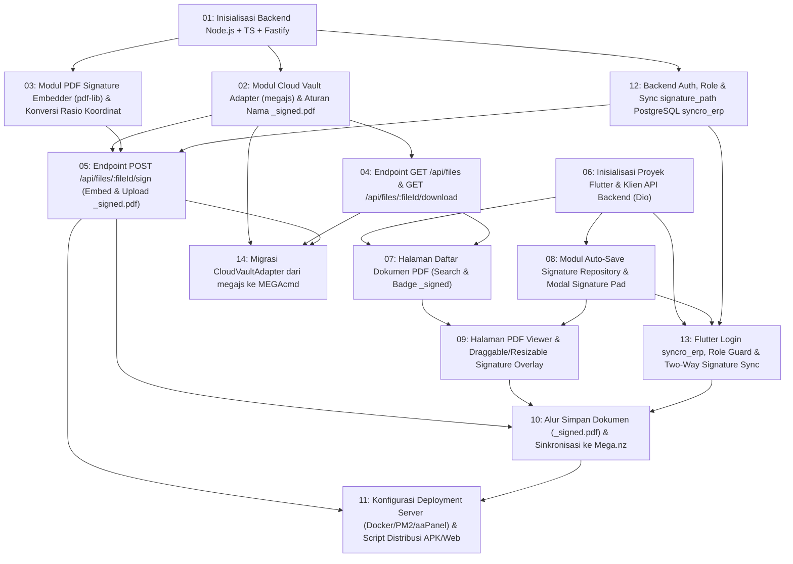

# Spec: MyAcrobat MVP — PDF Reader & Quick E-Signature (Mega.nz)

> **PRD Acuan:** [`PRD/PRD_MyAcrobat.md`](file:///C:/laragon/www/MyAcrobat/PRD/PRD_MyAcrobat.md)
> **Glossary Domain:** [`GLOSSARY.md`](file:///C:/laragon/www/MyAcrobat/GLOSSARY.md)
> **Stack:** Backend (`Node.js` + `TypeScript` + `Fastify` + `pdf-lib` + `megajs`) & Frontend (`Flutter` + `Riverpod` + `pdfrx` + `signature` + `dio`)

## Ringkasan Arsitektur & Seams (Batas Pengujian TDD)

Seluruh pekerjaan dipecah menjadi **10 tiket atomic** (masing-masing hanya mengerjakan **satu modul / satu tanggung jawab sempit** agar mudah di-review dan dieksekusi dengan siklus TDD *Red → Green*):

1. **Seam 1 — Cloud Vault Gateway (`MegaVaultAdapter`)**:
   - *Interface*: `listPdfFiles()`, `downloadPdf(fileId)`, `uploadSignedPdf(originalName, pdfBytes)`
   - *Apa yang diuji*: Filter hanya file `.pdf`, penanda `isSigned` untuk file `*_signed.pdf`, resolusi nama non-destruktif (`Dokumen.pdf` $\rightarrow$ `Dokumen_signed.pdf`), serta stream unduh/unggah.
2. **Seam 2 — PDF Signature Flattener (`PdfSignatureEmbedder`)**:
   - *Interface*: `embedSignature(pdfBytes, signaturePngBytes, placements[]) -> Uint8Array`
   - *Apa yang diuji*: Konversi koordinat rasio UI (`xRatio`, `yRatio` dari kiri-atas) ke koordinat PDF `pdf-lib` (`origin` kiri-bawah) di berbagai ukuran halaman tanpa merusak halaman lain.
3. **Seam 3 — Backend HTTP Contract (`Fastify App`)**:
   - *Interface*: `GET /api/files`, `GET /api/files/:fileId/download`, `POST /api/files/:fileId/sign`
   - *Apa yang diuji*: Validasi payload, status HTTP (`200`, `201`, `400`, `404`), dan alur orkestrasi *Download $\rightarrow$ Embed $\rightarrow$ Upload `_signed.pdf`*.
4. **Seam 4 — Flutter Local Signature Store (`SavedSignatureRepository`)**:
   - *Interface*: `getSavedSignature()`, `saveSignature(pngBytes)`, `clearSignature()`
   - *Apa yang diuji*: *Auto-save* saat pertama kali tanda tangan dibuat dan *immediate load* pada pemanggilan ke-2 dst.
5. **Seam 5 — Flutter Coordinate Normalizer & Placement State (`SignaturePlacementController`)**:
   - *Interface*: `addPlacement(pageIndex)`, `updatePlacementRect(...)`, `toNormalizedPayload(pageSize)`
   - *Apa yang diuji*: Perhitungan `xRatio`, `yRatio`, `widthRatio`, `heightRatio` (`0.0–1.0`) dari posisi drag/resize overlay di layar ke ukuran halaman PDF.

---

## Peta Tiket & Urutan Ketergantungan (*Dependency Graph*)

## Daftar Tiket Implementasi

| No | File Tiket | Fokus Pekerjaan (Single Responsibility) | Status | Blocked By |
| :--- | :--- | :--- | :--- | :--- |
| **01** | [`01-backend-scaffold-and-env-config.md`](file:///C:/laragon/www/MyAcrobat/.scratch/myacrobat-mvp/issues/01-backend-scaffold-and-env-config.md) | Setup proyek `backend/` (Node.js, TypeScript, Fastify, Vitest) & validasi config `.env` (Mega.nz + PostgreSQL `syncro_erp`) + endpoint `/health`. | `ready-for-agent` | - |
| **02** | [`02-mega-cloud-vault-adapter-and-signed-naming.md`](file:///C:/laragon/www/MyAcrobat/.scratch/myacrobat-mvp/issues/02-mega-cloud-vault-adapter-and-signed-naming.md) | Deep module `CloudVaultAdapter` (`megajs`) untuk list PDF, download buffer, upload file baru, dan helper nama `<name>_signed.pdf` non-destruktif. | `ready-for-agent` | `01` |
| **03** | [`03-pdf-signature-embedder-module.md`](file:///C:/laragon/www/MyAcrobat/.scratch/myacrobat-mvp/issues/03-pdf-signature-embedder-module.md) | Deep module `PdfSignatureEmbedder` (`pdf-lib`) untuk *flatten* PNG tanda tangan ke halaman PDF berdasarkan rasio koordinat (`0.0–1.0`). | `ready-for-agent` | `01` |
| **04** | [`04-backend-list-and-download-endpoints.md`](file:///C:/laragon/www/MyAcrobat/.scratch/myacrobat-mvp/issues/04-backend-list-and-download-endpoints.md) | Endpoint `GET /api/files` dan `GET /api/files/:fileId/download` beserta integration test HTTP. | `ready-for-agent` | `02` |
| **05** | [`05-backend-sign-and-upload-endpoint.md`](file:///C:/laragon/www/MyAcrobat/.scratch/myacrobat-mvp/issues/05-backend-sign-and-upload-endpoint.md) | Endpoint `POST /api/files/:fileId/sign` yang menggabungkan `download -> embed -> upload _signed.pdf` beserta validasi input. | `ready-for-agent` | `02, 03` |
| **06** | [`06-flutter-scaffold-and-api-client.md`](file:///C:/laragon/www/MyAcrobat/.scratch/myacrobat-mvp/issues/06-flutter-scaffold-and-api-client.md) | Setup proyek `app/` (Flutter + Riverpod + Dio) & modul `MyAcrobatApiClient` dengan model data kontrak backend. | `ready-for-agent` | - |
| **07** | [`07-flutter-document-list-screen.md`](file:///C:/laragon/www/MyAcrobat/.scratch/myacrobat-mvp/issues/07-flutter-document-list-screen.md) | Halaman daftar *Source Document* & *Signed Document* dari Mega.nz dengan fitur pencarian nama file, *pull-to-refresh*, dan badge `SIGNED`. | `ready-for-agent` | `04, 06` |
| **08** | [`08-flutter-autosave-signature-and-pad-modal.md`](file:///C:/laragon/www/MyAcrobat/.scratch/myacrobat-mvp/issues/08-flutter-autosave-signature-and-pad-modal.md) | Penyimpanan lokal *Saved Signature* (`saved_signature.png`) dengan *Auto-Save* pada pembuatan pertama, *One-Tap Reuse* pada pemakaian ke-2 dst., dan opsi "Gambar Ulang TTD". | `ready-for-agent` | `06` |
| **09** | [`09-flutter-pdf-viewer-and-signature-overlay.md`](file:///C:/laragon/www/MyAcrobat/.scratch/myacrobat-mvp/issues/09-flutter-pdf-viewer-and-signature-overlay.md) | Halaman *PDF Viewer* interaktif dengan *floating draggable & resizable signature overlay* serta kalkulasi koordinat rasio (`xRatio`, `yRatio`, `widthRatio`, `heightRatio`). | `ready-for-agent` | `07, 08` |
| **10** | [`10-flutter-save-signed-document-flow.md`](file:///C:/laragon/www/MyAcrobat/.scratch/myacrobat-mvp/issues/10-flutter-save-signed-document-flow.md) | Integrasi tombol "Simpan Dokumen" di Flutter ke `POST /api/files/:fileId/sign`, loading state, notifikasi sukses `<nama>_signed.pdf`, dan refresh daftar dokumen. | `ready-for-agent` | `05, 09` |
| **11** | [`11-deployment-and-app-distribution.md`](file:///C:/laragon/www/MyAcrobat/.scratch/myacrobat-mvp/issues/11-deployment-and-app-distribution.md) | Konfigurasi deployment Server Kantor (aaPanel Node Project / PM2 / Docker) + script build distribusi Flutter (`.apk`, Windows `.zip`, Web) & panduan `DEPLOY.md`. | `ready-for-agent` | `05, 10` |
| **12** | [`12-backend-syncro-auth-role-and-signature.md`](file:///C:/laragon/www/MyAcrobat/.scratch/myacrobat-mvp/issues/12-backend-syncro-auth-role-and-signature.md) | Integrasi Backend Node.js ke PostgreSQL `syncro_erp` (`users`, `module_role_assignments`, & sinkronisasi file `users.signature_path`). | `ready-for-agent` | `01` |
| **13** | [`13-flutter-syncro-login-role-and-signature-sync.md`](file:///C:/laragon/www/MyAcrobat/.scratch/myacrobat-mvp/issues/13-flutter-syncro-login-role-and-signature-sync.md) | Halaman Login `syncro_erp` di Flutter, proteksi UI berdasarkan Role (`admin`/`signer`/`viewer`), & sinkronisasi otomatis TTD `users.signature_path`. | `ready-for-agent` | `06, 08, 12` |
| **14** | [`14-backend-megacmd-cloud-vault-adapter.md`](file:///C:/laragon/www/MyAcrobat/.scratch/myacrobat-mvp/issues/14-backend-megacmd-cloud-vault-adapter.md) | Migrasi `CloudVaultAdapter` dari `megajs` ke CLI resmi `MEGAcmd` (`MegaCmdCloudVaultAdapter`) dengan sesi daemon persisten tanpa `MEGA_EMAIL`/`MEGA_PASSWORD` di `.env`. | `ready-for-agent` | `02, 04, 05` |
