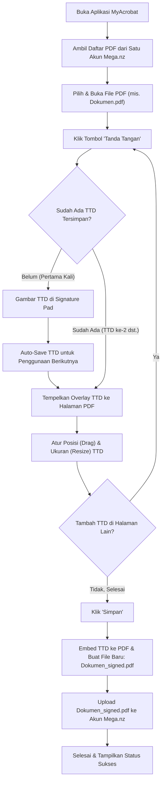

# Product Requirements Document (PRD): MyAcrobat

**Versi Dokumen:** 1.0 (MVP - Problem-Focused Release)  
**Tanggal:** 20 November 2026  
**Status:** Disetujui untuk Eksekusi  
**Stack Utama:** Flutter (Client) + Node.js (Backend Service) + Mega.nz (Single Central Storage)

---

## 1. Latar Belakang & Tujuan Produk

**MyAcrobat** adalah aplikasi pembaca dan penandatangan dokumen PDF (*PDF Reader & Quick E-Signature*) yang terintegrasi langsung dengan penyimpanan cloud **Mega.nz**.

Fokus utama rilisan ini (MVP) adalah **pemecahan masalah inti (*core problem solving*)**: mempercepat alur buka dokumen PDF dari cloud, membubuhkan tanda tangan secara instan tanpa harus menggambar ulang setiap kali menandatangani dokumen, dan menyimpan dokumen hasil tanda tangan kembali ke Mega.nz tanpa merusak dokumen asli.

---

## 2. Keputusan Arsitektur & Diskusi Teknis

Berdasarkan hasil diskusi teknis, berikut adalah ketetapan arsitektur untuk **MyAcrobat**:

1. **Arsitektur Teknis 1 — Opsi A (Hybrid Client-Preview & Flattened PDF Embedding):**
   - **Flutter Client** menangani tampilan dokumen PDF secara interaktif, pembuatan goresan tanda tangan (*signature pad*), serta *drag-and-drop / resize* posisi tanda tangan di atas halaman PDF untuk mendapatkan koordinat presisi (`pageIndex`, `x`, `y`, `width`, `height` ter-normalisasi terhadap dimensi halaman PDF).
   - **Proses Penempelan (*Flattening/Embedding*):** Gambar tanda tangan (PNG transparan) di-*embed* secara permanen (*flattened*) ke dalam layer halaman PDF pada koordinat yang dipilih sehingga tanda tangan menyatu dengan dokumen PDF dan tidak dapat digeser lagi oleh pembaca PDF standar.
2. **Rekomendasi Tech Stack Lengkap:**
   - **Frontend (Flutter):**
     - State Management: `Riverpod` (atau `Cubit/BLoC` ringan)
     - PDF Viewer & Coordinate Mapping: `pdfrx` atau `syncfusion_flutter_pdfviewer`
     - Signature Canvas: `signature` / `hand_signature` (ekspor PNG transparan resolusi tinggi)
     - Local Storage (Auto-Save Signature): `path_provider` + `shared_preferences` / `flutter_secure_storage` untuk menyimpan file aset tanda tangan lokal (`saved_signature.png`)
     - HTTP Client: `dio`
   - **Backend (Node.js + TypeScript + Shared PostgreSQL `syncro_erp`):**
     - Framework: `Fastify` (TypeScript)
     - Database & Auth Integration: `pg` + `bcryptjs` (terhubung langsung ke database PostgreSQL `syncro_erp` untuk membaca tabel `users`, `module_role_assignments` dengan `module_key = 'myacrobat'`, serta membaca/menyimpan spesimen tanda tangan pada `users.signature_path` di `storage/app/public/signatures/`)
     - PDF Manipulation Engine: `pdf-lib` (untuk *embedding* PNG tanda tangan ke halaman PDF secara cepat di memori tanpa ketergantungan binary OS eksternal)
     - Cloud Storage SDK: `megajs` (Node.js SDK untuk interaksi langsung ke Mega.nz)
3. **Integrasi User, Role & Tanda Tangan `syncro_erp`:**
   - Pengguna login menggunakan `username` (NIK) atau `email` dan `password` akun `syncro_erp` yang sudah ada.
   - Role pengguna dibaca dari tabel `module_role_assignments` (`module_key = 'myacrobat'`, misalnya `admin`, `signer` / penandatangan, atau `viewer`) maupun role global `syncro_erp`.
   - Jika `users.signature_path` di `syncro_erp` sudah terisi, aplikasi langsung mengunduh dan menggunakannya sebagai **Saved Signature** tanpa meminta user menggambar ulang. Jika belum ada, saat user menggambar tanda tangan pertama kali di MyAcrobat, sistem otomatis menyimpan (*auto-save*) file PNG tersebut ke `users.signature_path` (`syncro_erp`) sekaligus ke cache lokal perangkat.
4. **Integrasi Penyimpanan Cloud — Satu Akun Mega.nz Terpusat (*Single Mega Account*):**
   - Sistem menggunakan **satu akun Mega.nz terpusat** yang dikonfigurasi di sisi server Node.js melalui *environment variables* (`MEGA_EMAIL`, `MEGA_PASSWORD`, `MEGA_ROOT_FOLDER`).
   - User aplikasi tidak perlu login ke akun Mega.nz masing-masing; backend Node.js bertindak sebagai *storage gateway* tunggal untuk mengambil daftar file, mengunduh PDF, dan mengunggah hasil PDF yang telah ditandatangani.
4. **Kebijakan Penamaan & Penyimpanan File (`_signed`):**
   - Dokumen PDF asli di Mega.nz **tidak boleh ditimpa (*non-destructive*)**.
   - Setiap dokumen yang selesai ditandatangani akan disimpan sebagai **file baru** di folder terkait pada Mega.nz dengan menambahkan akhiran **`_signed`** sebelum ekstensi `.pdf`.
   - Contoh: `Surat_Perjanjian.pdf` $\rightarrow$ `Surat_Perjanjian_signed.pdf`.
5. **Batasan Scope (Fokus Pemecahan Masalah):**
   - Fitur sertifikat digital kriptografi (PKI/CA), *multi-user approval workflow* berjenjang, maupun manajemen multi-akun cloud **ditunda untuk fase berikutnya**. MVP berfokus penuh pada kecepatan dan keandalan alur **Buka PDF $\rightarrow$ Tanda Tangan (Auto-Save) $\rightarrow$ Simpan `_signed.pdf` ke Mega.nz**.

---

## 3. Spesifikasi Fitur Utama (MVP Scope)

### 3.1 Eksplorasi & Pembacaan Dokumen PDF (Mega.nz Integration)
- **Daftar Dokumen:** Menampilkan daftar file PDF dari folder kerja pada satu akun Mega.nz terpusat (beserta pencarian nama file & indikator apakah file sudah memiliki versi `_signed`).
- **PDF Viewer Interaktif:**
  - Navigasi halaman (*scroll*, *pinch-to-zoom*, indikator halaman aktif).
  - Tombol aksi cepat **"Bubuhkan Tanda Tangan"** pada halaman yang sedang dilihat.

### 3.2 Fitur Tanda Tangan dengan *Auto-Save* & *One-Tap Reuse*
- **Kondisi Pertama Kali Menandatangani (Belum Ada Tanda Tangan Tersimpan):**
  1. Saat user menekan tombol **"Tanda Tangan"**, aplikasi menampilkan modal *Signature Pad* (kanvas gambar tanda tangan dengan pilihan ketebalan/warna pena hitam/biru dan tombol *Clear*).
  2. Begitu user menekan **"Gunakan Tanda Tangan"**, aplikasi **otomatis menyimpan (*auto-save*)** gambar tanda tangan tersebut (PNG transparan) ke penyimpanan lokal perangkat.
  3. Tanda tangan langsung muncul sebagai *floatingresizable overlay* di atas halaman PDF aktif.
- **Kondisi Tanda Tangan Kedua dan Seterusnya (Sudah Ada Tanda Tangan Tersimpan):**
  1. Saat user menekan tombol **"Tanda Tangan"**, aplikasi **tidak meminta user menggambar ulang**, melainkan **langsung memuat tanda tangan yang sudah ter-*auto-save*** ke atas halaman PDF (atau menampilkan *quick bar* berisi *preview* tanda tangan tersimpan dengan 1 klik tempel).
  2. Tersedia tombol sekunder **"Gambar Ulang / Ganti TTD"** jika sewaktu-waktu user ingin memperbarui tanda tangan yang tersimpan.
- **Penempatan Tanda Tangan di Halaman PDF:**
  - User dapat menggeser (*drag*) posisi tanda tangan dan mengubah ukurannya (*resize* proporsional) di atas halaman PDF.
  - Mendukung pembubuhan tanda tangan di lebih dari satu posisi/halaman dalam satu sesi sebelum disimpan.

### 3.3 Proses Simpan & Sinkronisasi File `_signed`
- Saat user menekan tombol **"Simpan Dokumen"**:
  1. Aplikasi mengirimkan penempatan tanda tangan (koordinat halaman, posisi X/Y, lebar/tinggi, dan payload PNG tanda tangan) ke layanan pemrosesan PDF.
  2. Sistem menyatukan (*embed & flatten*) tanda tangan ke dalam struktur dokumen PDF.
  3. Sistem menghasilkan file baru dengan nama `<nama_asli>_signed.pdf` (apabila file yang dibuka sudah berakhiran `_signed.pdf` atau nama file yang sama sudah ada, sistem dapat menangani penomoran atau versi tanpa merusak file sumber asli).
  4. File `<nama_asli>_signed.pdf` diunggah kembali ke akun Mega.nz terpusat pada direktori yang sama dengan file sumber.
  5. User mendapatkan konfirmasi berhasil beserta opsi untuk langsung melihat atau membagikan file `_signed.pdf` tersebut.

---

## 4. Alur Pengguna (*User Flow*)



---

## 5. Kontrak API Backend (Node.js)

Backend Node.js menyediakan *endpoint* RESTful yang ringkas dan fokus pada pemecahan masalah:

| Method | Endpoint | Deskripsi |
| :--- | :--- | :--- |
| `GET` | `/api/files` | Mengambil daftar file PDF dari folder akun Mega.nz terpusat (`fileId`, `name`, `size`, `updatedAt`, `isSigned`). |
| `GET` | `/api/files/:fileId/download` | Mengalirkan (*stream*) binary PDF dari Mega.nz ke aplikasi Flutter. |
| `POST` | `/api/files/:fileId/sign` | Menerima gambar tanda tangan (Base64/Multipart PNG) + array penempatan (`[{ page, x, y, width, height }]`), menempelkannya ke PDF menggunakan `pdf-lib`, dan mengunggah file baru `<originalName>_signed.pdf` ke Mega.nz. |

### Contoh Payload `POST /api/files/:fileId/sign`
```json
{
  "signatureImageBase64": "data:image/png;base64,iVBORw0KGgoAAAANSUhEUgAA...",
  "placements": [
    {
      "pageIndex": 0,
      "xRatio": 0.62,
      "yRatio": 0.78,
      "widthRatio": 0.22,
      "heightRatio": 0.08
    }
  ]
}
```
> **Catatan Koordinat (`Ratio` 0.0 - 1.0):** Menggunakan rasio relatif terhadap lebar dan tinggi halaman PDF (`xRatio`, `yRatio`, `widthRatio`, `heightRatio`) agar posisi tanda tangan tetap 100% akurat di semua ukuran layar HP/tablet/desktop tanpa terpengaruh perbedaan DPI layar.

---

## 6. Kriteria Keberhasilan (Acceptance Criteria MVP)

1. **Koneksi Tunggal Mega.nz:** Backend berhasil terhubung ke 1 akun Mega.nz terpusat dan menampilkan daftar PDF di aplikasi Flutter.
2. **Auto-Save Tanda Tangan Pertama:** Setelah user menggambar tanda tangan pertama kali, aplikasi menyimpannya secara otomatis. Pada aksi tanda tangan kedua (baik di halaman lain maupun di dokumen lain), user langsung memakai tanda tangan tersebut tanpa menggambar ulang.
3. **Opsi Ganti Tanda Tangan:** User tetap memiliki tombol untuk menggambar ulang/mengganti tanda tangan tersimpan jika diperlukan.
4. **Akurasi Posisi Tanda Tangan:** Posisi dan ukuran tanda tangan pada file PDF hasil akhir sesuai secara presisi dengan posisi *preview* di layar Flutter.
5. **Output File Baru `_signed`:** Dokumen asli di Mega.nz tetap utuh, dan file baru bernama `<nama_file>_signed.pdf` berhasil tersimpan di Mega.nz.
